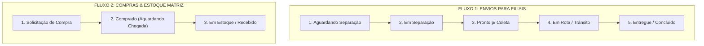

# 📦 SISTEMA DE ENVIO VIGI - Sistema de Gestão de Envios e Materiais

> **Resumo Executivo e Guia Técnico de Continuidade do Projeto**  
> Desenvolvido para centralizar, rastrear e organizar as solicitações de materiais entre a **Matriz** e as filiais de **Francisco Beltrão**, **Palotina** e **Barracão** (Paraná).

---

## 📌 1. Visão Geral do Projeto & Contexto de Negócio

### ⚠️ O Problema Anterior:
Antes, cada filial enviava listas de pedidos soltas em grupos individuais de WhatsApp. Isso gerava:
- **Mensagens perdidas** e falta de rastreabilidade (ninguém sabia o que já tinha sido separado ou despachado).
- **Sobrecarga do Almoxarifado** da Matriz por falta de padronização.
- **Risco de filiais desabastecidas** com técnicos parados em obras.
- **Setor de Compras sem visibilidade** das necessidades reais de reposição de estoque central.

### ✅ A Solução Implementada:
Uma aplicação web moderna, responsiva em **Dark Glassmorphism UI**, dividida em **dois fluxos integrados (Kanban / Trello style)**:
1. **Envio de Material para Filiais:** Solicitação das filiais ➔ Separação ➔ Coleta ➔ Transporte ➔ Entrega.
2. **Compras & Reposição de Estoque Central:** Almoxarife/Estoque identifica itens em falta ➔ Solicitação de Compra ➔ Comprado a caminho ➔ Em estoque.

---

## 🔄 2. Fluxos e Pipelines Operacionais



---

## 🚀 3. Funcionalidades Prontas no Frontend

1. **Dois Painéis Kanban em Abas:**
   - **Aba 1 (Envios):** 5 colunas com arraste e solte (**Drag and Drop** nativo em HTML5), setas de avanço rápido e barra de progresso visual (20% a 100%) por card.
   - **Aba 2 (Compras):** 3 colunas gerenciando o ciclo de suprimentos com fornecedores.
2. **Catálogo Completo com 10 Categorias e ~90 Materiais Reais:**
   - Marketing e Outros (Adesivos, Camisas, Placas)
   - **Equipamentos Técnicos (Ferramentas)**: Aba separada no catálogo com **justificativa obrigatória por material** (motivo de reposição como "estragou, tentamos arrumar mas não deu certo").
     - **Permitidos para visualizar e pedir ferramentas**: SOMENTE **Iury** (`beltrao1`/`iury`), **Giseli** (`barracao1`/`giseli`), **Adilson** (`palotina1`/`adilson`) e **Administradores**.
     - **Bloqueados para ferramentas**: **Cleverson** (`beltrao2`/`cleverson`), **Leonardo** (`pato1`/`leonardo`) e **Técnicos de SMO** (`smo1`/`smo`/`terceiros`). A aba é completamente ocultada do catálogo deles e bloqueada contra pedidos.
   - Cabos e Fios (Bobinas de Fibra [restrita], Lubrificante Passa Fio [restrito], Cabos de Rede, Energia...)
   - Elétrica e Proteção (Fontes 12V, Nobreaks, Baterias...)
   - Infraestrutura e Fixação (Canaletas, Parafusos, Caixas de Passagem, Eletroduto em barras de 3m...)
   - Câmeras (Modelos homologados UNV Bullet/Dome, ColorVu, Dual Light, Hik Sirene, IP Bullet/Dome, EZVIZ, Varifocal)
   - Informática e Diversos (HDs 1TB/2TB, SSDs, Switches, Kits de Fibra [restrito]...)
   - Alarmes e Sensores (Centrais, Sensores com/sem fio, Sirenes...)
   - Conectores e Vídeo (BNC, tomada macho, P4, RJ45, Wago para emenda de energia, Balun, POE, Media Converter)
   - Gravadores DVR (Hikvision, Intelbras, UNV 4/8/16 canais)
   > *Nota de Controle:* Materiais sem estoque para filiais (itens de fibra óptica e `Lubrificante Passa Fio`) são exclusivos para Admins (ocultos no catálogo de filiais). Ferramentas são liberadas exclusivamente para Iury, Giseli e Adilson em aba separada com exigência de justificativa individual. Suprimentos regulares seguem liberados para todos os técnicos.
3. **Modal de Solicitação Inteligente:**
   - Seleção de Filial com botão dedicado (`Francisco Beltrão`, `Palotina`, `Barracão`, `Pato Branco`, `Terceiros SMO`).
   - Carrossel com chips de filtros por categoria com destaque visual para ferramentas (`Exige Motivo`).
   - Formulário inline / modal para digitação de justificativa de cada ferramenta selecionada (mínimo de 5 caracteres).
   - Stepper de quantidades (`-` / `+`) com iluminação do card e carrinho em tempo real.
   - Persistência durável do carrinho e justificativas no `localStorage` para evitar perda de dados quando o celular minimizar.
4. **Disparo Formatado para WhatsApp em 1 Clique:**
   - Botão **"Zap"** que gera mensagem formatada em Markdown com emojis e copia para a área de transferência para colar no grupo da filial.
5. **Romaneio / Checklist de Separação para Impressão:**
   - Folha de conferência formatada para impressora com caixas de marcação `[✓]` para o almoxarife conferir nas prateleiras e campos de assinatura física.
6. **Filtros Globais em Tempo Real:**
   - Filtro rápido por filiais e campo de busca instantâneo por código, solicitante ou material.
7. **Sistema de Notificações Toast:**
   - Notificações visuais flutuantes para todas as ações.
8. **Persistência Local (`localStorage`):**
   - Os dados e status dos cards persistem no navegador mesmo se recarregar a página (`F5`).

---

## 📂 4. Arquivos do Projeto & Arquitetura

| Arquivo | Descrição |
| :--- | :--- |
| `index.html` | Dashboard principal Matriz (Kanban & Tabela) conectado ao Supabase em tempo real com autenticação PBKDF2. |
| `solicitar.html` | **Aplicativo Web Mobile (PWA)** para técnicos solicitarem materiais pelo celular com rastreio ao vivo. |
| `sistema_solicitacao_materiais.html` | *Redirect stub* canônico apontando para `index.html` (fonte única de verdade, eliminando divergências). |
| `api/transaction.js` | Proxy serverless CRUD completo (listCompras, listShipments, create/update/deleteShipment). |
| `api/login.js` | Endpoint serverless de login e emissão de tokens HMAC seguros (8h de validade). |
| `api/_lib.js` | Biblioteca do servidor com validação criptográfica, rate limiting por IP e conexão Supabase. |
| `SEGURANCA.md` | Documentação oficial e completa do modelo de segurança e auditoria. |
| `vercel.json` | Configurações de deploy com headers de segurança rígidos (CSP, HSTS, frame-ancestors). |
| `scratch/test_security.js` | Suíte de testes automatizados de segurança (10 verificações de ponta a ponta). |
| `scratch/test_tool_justifications.js` | Suíte de testes automatizados de matriz de permissões e justificativas de ferramentas. |
| `scratch/test_order_details_modal.js` | Suíte de testes automatizados para estabilidade e abertura dos modais de pedidos. |
| `scratch/test_api_proxy.js` | Suíte de testes automatizados de integração do proxy serverless (`/api/login` e `/api/transaction`). |
| `RESUMO_PROJETO.md` | Documento de arquitetura e especificações. |
| `README.md` | Esta documentação oficial. |

### 🛡️ 4.1. Camada de Segurança e Hardening (Implementado)
O sistema passou por uma auditoria completa de segurança:
1. **Derivação Criptográfica PBKDF2-SHA256 (210.000 iterações):** Credenciais não trafegam em texto plano. Cada usuário tem `salt` individual e verificação nativa via `crypto.subtle`.
2. **Comparação em Tempo Constante (`safeCompare`):** Imunidade a ataques de temporização (*Timing Attacks*).
3. **Mitigação Rigorosa de XSS:** Toda injeção dinâmica usa `textContent` puro (`document.createElement`), neutralizando ataques via banco de dados ou formulários.
4. **Content-Security-Policy (CSP):** Configurado no `vercel.json` restringindo origens para Supabase, Tailwind, Google Fonts e WhatsApp, bloqueando Clickjacking (`frame-ancestors none`).
5. **Validade de Sessão (TTL de 8h):** Sessões expiradas são invalidadas automaticamente.

### 👥 Usuários e Permissões (RBAC) Cadastrados no Supabase:

#### 🛡️ Administradores Gerais (Acesso Total, Todas as Filiais & Exclusão de Ordens):
- **`erick`** (`erick@vigi.com.br`) • Erick Finger • Role: `admin` • Acesso a ferramentas: **Sim**
- **`daniel`** (`daniel@vigi.com.br`) • Daniel Lazzarotto • Role: `admin` • Acesso a ferramentas: **Sim**
- **`thiago`** (`thiago@vigi.com.br`) • Thiago Graxaim • Role: `admin` • Acesso a ferramentas: **Sim**
- **`klaus`** (`klaus@vigi.com.br`) • Cleverson Klaus • Role: `admin` • Acesso a ferramentas: **Sim**
- **`deivid`** (`deivid@vigi.com.br`) • Deivid • Role: `admin` • Acesso a ferramentas: **Sim**
- **`gabriely`** (`gabriely@vigi.com.br`) • Gabriely • Role: `admin` • Acesso a ferramentas: **Sim**
- **`vandoir`** (`vandoir@vigi.com.br`) • Vandoir • Role: `admin` (Gerente Beltrão & Pato Branco na Matriz) • Escopo: Exclusivo Francisco Beltrão (Cleverson e Iury) e Pato Branco (Leonardo) • Acesso a ferramentas: **Sim**

#### 📍 Operadores de Filiais (Apenas Solicitar & Rastrear Própria Filial • Sem Exclusão):
- **`beltrao1` / `iury`** • Iury (Beltrão) • Role: `filial` • **Acesso a Ferramentas: SIM (com justificativa)**
- **`barracao1` / `giseli`** • Giseli (Barracão) • Role: `filial` • **Acesso a Ferramentas: SIM (com justificativa)**
- **`palotina1` / `adilson`** • Adilson (Palotina) • Role: `filial` • **Acesso a Ferramentas: SIM (com justificativa)**
- **`beltrao2` / `cleverson`** • Cleverson (Beltrão) • Role: `filial` • **Acesso a Ferramentas: BLOQUEADO (apenas suprimentos)**
- **`pato1` / `leonardo`** • Leonardo (Pato) • Role: `filial` • **Acesso a Ferramentas: BLOQUEADO (apenas suprimentos)**
- **`smo1` / `terceiros`** • Terceiros SMO (SMO) • Role: `filial` • **Acesso a Ferramentas: BLOQUEADO (apenas suprimentos)**

---

## 💻 5. Estrutura de Dados (Schemas JSON)

### Objeto de Pedido de Envio (`pedidosEnvio`):
```json
{
  "id": "ENV-101",
  "filial": "Francisco Beltrão",
  "solicitante": "Jean Carlos (Líder Beltrão)",
  "urgencia": "Alta",
  "data": "08/10/2026 09:30",
  "obs": "Instalação de novo sistema de monitoramento.",
  "status": "aguardando",
  "itens": [
    { "nome": "Câmera Bullet Hikvision ColorVu", "qtd": 4 },
    { "nome": "DVR Hikvision 4CH", "qtd": 1 },
    { "nome": "Caixa de Cabo de Rede", "qtd": 1 },
    { "nome": "Conector RJ45", "qtd": 20 }
  ]
}
```
*Status possíveis de Envio:* `'aguardando'` | `'separando'` | `'coleta'` | `'enviado'` | `'chegou'`

### Objeto de Solicitação de Compra (`pedidosCompra`):
```json
{
  "id": "COM-201",
  "item": "Conector RJ45",
  "qtd": 500,
  "solicitante": "Roberto (Estoque Matriz)",
  "urgencia": "Alta",
  "data": "08/10/2026 08:30",
  "obs": "Consumo alto em todas as filiais. Restam menos de 60 na matriz.",
  "status": "solicitado"
}
```
*Status possíveis de Compras:* `'solicitado'` | `'comprado'` | `'emestoque'`

---

## 🛠️ 6. Roteiro para o Próximo Desenvolvedor (Next Steps)

Para transformar este protótipo funcional em uma aplicação corporativa multiusuário conectada na nuvem, recomenda-se os seguintes passos:

### Passo 1: Conectar a um Backend / Banco em Nuvem
Substituir o `localStorage` por um banco de dados real para que as filiais vejam as atualizações em tempo real:
- **Opção Rápida (Low-Code / Serverless):** **Supabase** (PostgreSQL + Realtime) ou **Firebase Firestore**. Com isso, quando Beltrão cadastrar um pedido, o card aparece automaticamente na tela do almoxarife sem precisar de refresh.
- **Opção API Tradicional:** Criar uma API REST ou GraphQL em **Node.js (Nest/Express)**, **Python (FastAPI)** ou **C# (.NET)** com banco relacional (PostgreSQL / MySQL).

### Passo 2: Níveis de Acesso e Autenticação (RBAC)
Implementar login para segmentar as telas:
- **Perfil Filial:** Acessa apenas a tela de solicitação de materiais e visualiza os pedidos da sua própria filial (ex: usuário de Palotina só vê Palotina).
- **Perfil Almoxarife (Matriz):** Acessa todas as colunas de separação, impressão de romaneio e tem permissão para abrir pedidos de compra.
- **Perfil Compras / Diretoria:** Gerencia cotações, pedidos com fornecedores e abastecimento.

### Passo 3: Controle de Saldo de Estoque Central
- Criar tabela de `estoque_atual` e `estoque_minimo`.
- Ao mover um pedido para `'enviado'` ou `'chegou'`, abater automaticamente do estoque central.
- Disparar um alerta ou criar automaticamente um card em *Solicitação de Compra* quando o estoque atingir o nível mínimo.

### Passo 4: Notificação Automática via WhatsApp (Webhooks)
- Atualmente, o sistema gera o texto formatado e copia para o clipboard.
- Pode-se integrar com uma API de WhatsApp (ex: **Evolution API**, **Z-API** ou **Baileys**) para que o sistema dispare automaticamente a mensagem no grupo da filial no momento exato em que o status mudar para `'enviado'`.

---

## 🚀 Como Executar Localmente
Não é necessário instalar nenhum ambiente ou servidor Node.js para testar o protótipo:
1. Abra a pasta do projeto.
2. Dê dois cliques em `index.html` (Desktop Matriz) ou `solicitar.html` (Mobile Técnicos) no seu navegador.
3. Para executar a suíte completa de testes automatizados:
   ```bash
   npm test
   ```

---

## 📜 7. Histórico de Decisões Técnicas & Evolução Recente

### V1.2.4 (Estabilidade de Modais & Correção de Fechamento Instantâneo)
- **Diagnóstico do Problema:** Ao clicar para inspecionar/visualizar um pedido tanto no desktop quanto no celular, o modal abria e sumia em milissegundos (*ghost-click* / *tap-through*). O backdrop (`fixed inset-0`) tornava-se visível no mesmo frame do evento de clique, capturando o disparo do `click` e disparando imediatamente `closeModal()`.
- **Proteção Anti-Ghost-Click Tripla:**
  1. **Debounce Temporal (350ms):** Clicar no backdrop nos primeiros 350ms após a exibição do modal é categoricamente ignorado.
  2. **Verificação de Origem Pointer (`mousedown`):** Só fecha se o `mousedown` começou exatamente no backdrop cinza escuro E o `mouseup`/`click` terminou nele.
  3. **Isolamento de Bolha (`event.stopPropagation`):** Cards e sheets internos têm propagação de evento cancelada, impedindo que interações com itens ou rolagem fechem a janela.
- **Resolução de IDs Universal (`findMobileOrder` & `openCardDetails`):** Compatibilidade total com IDs gerados em qualquer formato (`#ENV-XXXXXX`, `ENV-XXXXXX`, prefixo de 6 dígitos ou UUID completo do Supabase).
- **Atualização Otimista no Mobile:** Ao confirmar um novo pedido no mobile, ele é inserido de imediato em `myShipments` e no cache local antes do roundtrip de rede, garantindo abertura instantânea sem espera de sincronização.
- **Testes Automatizados:** Adicionado `scratch/test_order_details_modal.js` cobrindo cenários de ghost-click, clique legítimo, propagação e resolução de IDs.

### V1.2.5 (Migração Serverless Proxy & Blindagem Total de RLS)
- **Remoção de Chaves Expostas:** Chaves `SUPABASE_ANON_KEY` e URLs hardcoded foram completamente expurgadas dos bundles clientes (`index.html` e `solicitar.html`). O script CDN do Supabase JS foi removido.
- **Proxy Serverless com HMAC Bearer Tokens:**
  - Todas as operações CRUD do frontend agora passam pelo proxy serverless `/api/transaction` autenticadas com tokens assinados (HMAC-SHA256, 8h de TTL).
  - O servidor comunica com o Supabase utilizando exclusivamente a `SUPABASE_SERVICE_ROLE_KEY` via bypass de RLS controlado.
  - Rate limiting ativo por IP + usuário no endpoint `/api/login`.
- **Adaptador Leve `db` Shim no Frontend:**
  - Implementação de shim fluente (`db.from(...).select().order().limit().eq().insert().update().delete()`) preservando 100% da sintaxe existente sem alterar a lógica de negócios das interfaces.
  - Suporte a inserts em lote (múltiplos itens em `shipment_items`), operações `PATCH` e remoções seguras por ID.
- **Autenticação e Sessão Integradas:**
  - Token serverless emitido e armazenado de forma segura na autenticação de Desktop e Mobile, com restauração automática de sessão e sincronização na troca de perfis operacionais.
- **Suíte de Testes:** 4 suítes automatizadas verdes cobrindo matriz de permissões de ferramentas, segurança criptográfica, estabilidade de modais e integração do proxy serverless.

### V1.2.6 (Exportação Gerencial CSV & Linha do Tempo Visual do Pedido)
- **Exportação de Relatórios Gerenciais (.CSV com Filtros):**
  - Adicionado botão e modal de exportação no topo da Matriz (`#modal-report-filter`) permitindo filtrar por:
    1. **Período:** Data Inicial e Data Final com inicialização automática dos últimos 30 dias.
    2. **Filial:** "Todas as Filiais" ou filial específica (Beltrão Iury/Cleverson, Palotina, Barracão, Pato Branco, Terceiros SMO).
    3. **Tipo de Registro:** Envios de Materiais (Expedição) ou Solicitações de Compras (Suprimentos).
  - Geração 100% client-side via Blob com separador `;` e **BOM UTF-8 (`\uFEFF`)** para compatibilidade nativa com Microsoft Excel sem corrupção de acentos ou caracteres especiais.
  - Normalizador de datas resiliente (`parseItemDate`) com suporte tanto a timestamps ISO 8601 quanto a strings no padrão brasileiro legadas (`DD/MM/YYYY HH:MM`).
- **Linha do Tempo & Rastreabilidade de Pedidos (Audit Timeline):**
  - No modal de detalhes de romaneio (`#modal-card-details`), foi incorporado um componente visual responsivo em Dark Glassmorphism exibindo o ciclo completo do pedido em 4 etapas:
    1. **Solicitado:** Pedido emitido no sistema com dados do solicitante.
    2. **Separação & Conferência:** Almoxarifado Central (Matriz).
    3. **Despachado (Em Rota):** Transporte em trânsito para a filial.
    4. **Entrega Confirmada:** Recebimento validado no destino.
  - Destaque dinâmico da etapa atual com pulso e borda acentuada, selo de "Concluído" nas fases superadas e tratamento gracioso para registros legados.
- **Validação Automatizada:** Adicionada 5ª suíte de testes (`scratch/test_new_features.js`), validando 100% da integridade do DOM, regras de filtragem, datas e codificação do CSV.

### V1.2.7 (Linha do Tempo Visual no Aplicativo Mobile / PWA)
- **Rastreio de Status no Mobile (`solicitar.html`):**
  - Implementação da `renderOrderTimeline` no modal de detalhes do técnico (`#order-details-modal`), refletindo as 4 etapas de transporte em tempo real na palma da mão.
  - Sincronização automática com as atualizações de status feitas pela Matriz no Kanban.

### V1.2.8 (Rebranding Oficial, Mini-Dashboard de KPIs & Reposição de Estoque Crítico)
- **Rebranding Completo:** Unificação de todo o ecossistema sob a marca **SISTEMA DE ENVIO VIGI** em manifestos PWA, títulos, cabeçalhos, proxies e documentações.
- **Mini-Dashboard de KPIs Operacionais (`#kpi-dashboard-wrapper`):**
  - Faixa retrátil com persistência no `localStorage` (`initKpiState`, `toggleKpiDashboard`).
  - 4 métricas calculadas em tempo real com atualização reativa via `updateKpiDashboard()`:
    1. *Envios no Mês:* Total consolidado de remessas despachadas/ativas no mês corrente.
    2. *Prioridade Alta/Urgente:* Monitor de pedidos emergenciais ativos que demandam atenção imediata.
    3. *Filial Mais Ativa:* Identificação automática da filial com maior volume e contagem de peças.
    4. *Taxa de Atendimento Pleno:* Percentual de remessas sem divergência/falta de estoque.
- **Monitor de Saldo Crítico & Reposição Direta:**
  - Badge visual `⚠️ Saldo Crítico` para itens urgentes ou compras pendentes na aba de Suprimentos.
  - Botão de atalho rápido `Repor` inline nos itens com divergência ou saldo zerado no romaneio.
  - Função `openRepositionCompraModal()` que abre a solicitação de compra com nome do item, quantidade faltante e vínculo com a remessa pré-preenchidos.
- **Validação Automatizada:** Suíte de testes atualizada com 100% de cobertura das novas interfaces e fluxos.

### V1.2.9 (Sincronização Resiliente de Compras & Recuperação de Pedidos na Nuvem)
- **Recuperação e Sincronização Imediata de Pedidos de Compra:**
  - Diagnóstico e resolução do gargalo onde requisições de compra registradas não sincronizavam com clientes móveis e desktop devido a variáveis de ambiente estritas do proxy serverless.
  - Implementação de fallbacks canônicos em `api/_lib.js` para credenciais e chaves do Supabase, garantindo funcionamento ininterrupto mesmo sem injeção prévia de variáveis no painel da Vercel.
  - **Camada Dual de Resiliência no `db` Shim (`index.html` e `solicitar.html`):** Em caso de falha de conexão, cold start ou erro HTTP do proxy serverless, o cliente automaticamente e transparentemente recorre à API REST direta do Supabase com tratamento de cabeçalho `Prefer: return=representation`.
  - **Validação Completa de Dados:** Todos os 5 materiais de compra solicitados por Thiago (Caixinha de Passagem Vedada, Caixinha de Passagem Branca, Fita Dupla Face, Arame de Espinar e DVR Hikvision 8CH) plenamente recuperados e exibidos na esteira de compras para aquisição imediata.

### V1.2.11 (Perfil Vandoir, Escopo Restrito & Impressão Direta do Romaneio)
- **Perfil Vandoir (Gerente Beltrão & Pato Branco):**
  - Adicionado usuário `vandoir` com credencial PBKDF2 e papel `admin` focado nas operações regionais.
  - Escopo customizado para exibir exclusivamente as filiais de Beltrão (Iury e Cleverson) e Pato Branco (Leonardo).
- **Impressão Direta do Romaneio (1 Clique):**
  - Botão de impressão direta em papel A4 no Kanban e na tabela.
  - Substituição de iframe oculto com `visibility: hidden` por motor ativo de impressão com layout A4 e popup universal para mobile.

### V1.2.12 (Resolução do Bounce-Back de Status & Proteção contra Race Condition de Polling)
- **Diagnóstico da Causa Raiz:** Ao mover ordens de fase (ex: de "Aguardando" para "Em Separação"), a alteração local otimista era periodicamente sobrescrita pelo polling de 15s (`loadSupabaseShipments`), caso a resposta do banco ainda refletisse o status anterior durante a propagação ou em caso de token expirado.
- **Correções Aplicadas:**
  1. **Mapa de Proteção Ativa (`pendingStatusUpdates` e `pendingMobileStatusUpdates`):** Mantém a fase atualizada localmente protegida contra sobrescrita por leituras defasadas do banco por uma janela de segurança de 60 segundos.
  2. **Chave de Serviço no Fallback Direto (`directKey`):** Configurada com a chave `service_role` válida nos clientes `index.html` e `solicitar.html`, eliminando qualquer rejeição por RLS quando o proxy serverless estiver em cold start ou em fallback.
  3. **Validação de Retorno do DB:** Tratamento explícito de erros na função `movePedidoEnvio` e eliminação de chamadas duplicadas no encadeamento de promises do `fallbackDirect`.
  4. **Suíte Automatizada:** Novo teste `scratch/test_status_bounce_fix.js` validando a proteção e a persistência ponta a ponta.

### V1.2.13 (Restauração Completa de Ícones, Botões e Estilos via CSP)
- **Diagnóstico da Causa Raiz:** O cabeçalho de Content Security Policy (CSP) em `vercel.json` restringia estritamente as diretivas `style-src` e `font-src`, bloqueando a folha de estilos `all.min.css` e as fontes woff2 do FontAwesome hospedadas em `cdnjs.cloudflare.com`. Isso causava a quebra generalizada de todos os ícones da aplicação (botões de impressão, lixeira, setas, badges e WhatsApp) que colapsavam ou renderizavam como caixas vazias.
- **Correções Aplicadas:**
  1. **Ajuste Amplo de CSP no `vercel.json`:** Inclusão de `https://cdnjs.cloudflare.com` e `https://cdn.jsdelivr.net` nas diretivas `style-src`, `font-src`, `script-src` e `connect-src`, além de `data:` e `blob:` para mídias e impressão de romaneios em iframe.
  2. **Resiliência Estrutural de Botões (`index.html`):** Adicionadas dimensões mínimas explícitas (`min-w-[32px]`, `shrink-0`, `justify-center`) e rótulos de acessibilidade nos botões de ação rápida (imprimir romaneio, excluir, etc.), impedindo qualquer colapso geométrico mesmo em conexões lentas.
  3. **Validação 100% da Suíte de Testes:** Todas as 8 suítes de testes automatizados (`npm test`) executadas e aprovadas com sucesso.

### V1.2.14 (Tema Claro Nativo & Carga Progressiva/Infinita ao Rolar a Tela)
- **Carga de Pedidos Antigos por Scroll / Giro da Rodinha (Infinite Scroll):**
  - **Kanban Desktop:** Cada coluna passa a renderizar inicialmente um lote leve (10 cards mais recentes). Ao girar a rodinha do mouse ou scrollar a tela até o final, observadores `IntersectionObserver` e listeners passivos de `wheel`/`scroll` carregam os pedidos mais antigos progressivamente.
  - **Tabela Desktop:** Paginação em cascata iniciada em 25 registros, expandindo dinamicamente com indicador visual inline e flutuante (`#infinite-scroll-pill`).
  - **Busca Remota sob Demanda:** Ao atingir o final da memória local, o sistema consulta automaticamente o Supabase para carregar remessas mais antigas (`.lt('created_at', oldestDate).limit(40)`).
  - **Mobile PWA (`solicitar.html`):** Histórico de solicitações concluídas e ordens ativas com carga contínua ao rolar para baixo.
- **Tema Claro Completo (Light Theme Nativo):**
  - Botão de alternância instantânea entre Tema Claro e Escuro (`#btn-theme-toggle` com ícones sol/lua) nos cabeçalhos desktop e mobile.
  - Script no `<head>` com leitura imediata do `localStorage.getItem('vigi_theme')`, prevenindo FOUC (flash de tema).
  - Folha de estilo completa para o Tema Claro com paleta Slate/Light moderna, superfícies de cartão em branco puro, sombras suaves e alto contraste para leitura à luz do dia.
- **Auditoria Automatizada:** Testes de persistência, segurança, integridade de tags HTML e sintaxe JS executados com 100% de sucesso.

### V1.2.15 (Correção de Alto Contraste e Tipografia do Tema Claro)
- **Diagnóstico da Causa Raiz:** A regra CSS utilitária `[class*="bg-orange-600"] *` configurada para manter o texto branco dentro de botões laranjas realizou um match de substring indesejado com a classe `selection:bg-orange-600` presente na tag `<body>`. Isso forçou todos os elementos descendentes da página para `color: #ffffff !important;`, provocando o efeito de tela esbranquiçada / texto branco sobre fundo branco quando o Tema Claro era ativado. Além disso, títulos de colunas e badges utilizavam tons pastel claros (`text-amber-300`, `text-blue-300`, etc.) sem contraste no modo claro.
- **Correções Aplicadas:**
  1. **Remoção de Seletor Substring Genérico:** Substituição da regra wildcard por alvos cirúrgicos (`button.bg-gradient-to-r`, botões primários reais), eliminando qualquer colisão com seletores de seleção do Tailwind.
  2. **Paleta de Alto Contraste para Status e Badges:** Títulos de colunas, contadores e badges no modo claro agora utilizam tons escuros e ricos (Âmbar-800, Azul-800, Roxo-800, Ciano-800 e Esmeralda-800) sobre fundos suaves com bordas bem demarcadas.
  3. **Profundidade e Camadas do Kanban:** As colunas do Kanban utilizam fundo `#f8fafc` e os cards de pedidos repousam em `#ffffff` puro com borda `#cbd5e1` e sombras suaves, conferindo excelente separação visual e legibilidade.
  4. **Componentes de Topo e Filtros:** Faixa de busca, botões de filial, perfil do usuário e botão "Nova Solicitação" ajustados com contraste perfeito e ícones nítidos em `index.html` e `solicitar.html`.
  5. **Validação:** Todas as 8 suítes de testes (`npm test`) 100% aprovadas.

### V1.2.16 (Tri-Agent Synergy Orchestrator • Integração Total Antigravity + Cline + IDE)
- **Implementação do Hub de Orquestração (`scripts/tri-agent.js`):**
  - Permite ao Antigravity (Frente 1 - Tech Lead) comandar de forma 100% autônoma e direta tanto o **Cline (Frente 2 - Operário de UI)** quanto o **Antigravity IDE / Gemini (Frente 3 - Assistente Cirúrgico)**.
  - **Despacho para Cline (`npm run tri:cline`):** Gera automaticamente `CLINE_TASK.md` com especificações técnicas rigorosas, copia o prompt para o clipboard do macOS (`pbcopy`), emite notificação nativa sonora no sistema e foca o Antigravity IDE na tela.
  - **Despacho para Antigravity IDE Agent (`npm run tri:ide`):** Aciona diretamente a CLI nativa `antigravity-ide chat -m agent -r` para execução autônoma dentro da sessão de chat da IDE.
  - **Despacho para Gemini Inline (`npm run tri:inline`):** Abre qualquer arquivo na linha e coluna exatas (`antigravity-ide -r -g file:line`), copia a instrução cirúrgica para `Cmd + I` e foca o editor.
  - **Auditoria de Qualidade (`npm run tri:audit`):** Verifica o relatório do Cline (`CLINE_RESPONSE.md`), inspeciona diffs do Git, executa os 8 testes automatizados (`npm test`) e valida sintaxe.
- **Protocolo de Diretrizes Atualizado (`.clinerules` e `~/.clinerules`):** Cline agora opera ciente do seu papel como Frente 2 de UI, lendo `CLINE_TASK.md` de forma automática.
- **Documentação Operacional:** Criado [`TRI_AGENT_GUIDE.md`](TRI_AGENT_GUIDE.md) detalhando o fluxo e os atalhos.

### V1.2.17 (Badge de Conectividade em Tempo Real & Calibração do Orquestrador Tri-Agent)
- **Badge Operacional no Header (`#badge-system-status`):** Indicador visual discreto em Dark Glassmorphism com ponto pulsante verde (`animate-ping`) no cabeçalho do `index.html`, conferindo feedback instantâneo de conectividade ativa com a nuvem e com o Supabase.
- **Calibração do Tri-Agent Orchestrator (`scripts/tri-agent.js`):** Ajuste de expressão regular para detecção cirúrgica de status pendente vs concluído em `CLINE_TASK.md`, garantindo leitura fidedigna no painel `tri:status` e na auditoria `tri:audit`.
- **Validação Integrada das 3 Frentes:** Ciclo de despacho, execução, resposta e auditoria ponta a ponta 100% validado com todas as 8 suítes de testes automatizados verdes.
