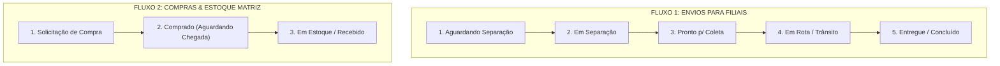

# 📦 SISTEM ENVIO VIGI - Sistema de Gestão de Envios e Materiais

> **Resumo Executivo e Guia Técnico de Continuidade do Projeto**  
> Desenvolvido para centralizar, rastrear e organizar as solicitações de materiais entre a **Matriz** e as filiais de **Francisco Beltrão**, **Palotina** e **Barracão** (Paraná).

---

## 📌 1. Visão Geral do Projeto & Contexto de Negócio

### ⚠️ O Problema Anterior:
Antes, cada filial enviava listas de pedidos soltas em grupos individuais de WhatsApp. Isso gerava:
- **Mensagens perdidas** e falta de rastreabilidade (ninguém sabia o que já tinha sido separado ou despachado).
- **Sobrecarga do Almoxarifado** da Matriz por falta de padronização.
- **Risco de filiais desabastecidas** com técnicos parados em obras.
- **Setor de Compras sem visibilidade** das necessidades reais de reposição de estoque central.

### ✅ A Solução Implementada:
Uma aplicação web moderna, responsiva em **Dark Glassmorphism UI**, dividida em **dois fluxos integrados (Kanban / Trello style)**:
1. **Envio de Material para Filiais:** Solicitação das filiais ➔ Separação ➔ Coleta ➔ Transporte ➔ Entrega.
2. **Compras & Reposição de Estoque Central:** Almoxarife/Estoque identifica itens em falta ➔ Solicitação de Compra ➔ Comprado a caminho ➔ Em estoque.

---

## 🔄 2. Fluxos e Pipelines Operacionais



---

## 🚀 3. Funcionalidades Prontas no Frontend

1. **Dois Painéis Kanban em Abas:**
   - **Aba 1 (Envios):** 5 colunas com arraste e solte (**Drag and Drop** nativo em HTML5), setas de avanço rápido e barra de progresso visual (20% a 100%) por card.
   - **Aba 2 (Compras):** 3 colunas gerenciando o ciclo de suprimentos com fornecedores.
2. **Catálogo Completo com 10 Categorias e ~90 Materiais Reais:**
   - Marketing e Outros (Adesivos, Camisas, Placas)
   - Ferramentas e Equipamentos Técnicos (Alicates, Furadeiras, Parafusadeiras...)
   - Cabos e Fios (Bobinas de Fibra, Cabos de Rede, Energia...)
   - Elétrica e Proteção (Fontes 12V, Nobreaks, Baterias...)
   - Infraestrutura e Fixação (Canaletas, Parafusos, Caixas de Passagem...)
   - Câmeras (Hikvision, UNV, ColorVu, IP, Dome, Bullet...)
   - Informática e Diversos (HDs 1TB/2TB, SSDs, Switches, Kits de Fibra...)
   - Alarmes e Sensores (Centrais, Sensores com/sem fio, Sirenes...)
   - Conectores e Vídeo (RJ45, Balun, P4, BNC, Conector Wago...)
   - Gravadores DVR (Hikvision, Intelbras, UNV 4/8/16 canais)
3. **Modal de Solicitação Inteligente:**
   - Seleção de Filial com botão dedicado (`Francisco Beltrão`, `Palotina`, `Barracão`).
   - Carrossel com chips de filtros por categoria.
   - Stepper de quantidades (`-` / `+`) com iluminação do card e carrinho em tempo real.
4. **Disparo Formatado para WhatsApp em 1 Clique:**
   - Botão **"Zap"** que gera mensagem formatada em Markdown com emojis e copia para a área de transferência para colar no grupo da filial.
5. **Romaneio / Checklist de Separação para Impressão:**
   - Folha de conferência formatada para impressora com caixas de marcação `[✓]` para o almoxarife conferir nas prateleiras e campos de assinatura física.
6. **Filtros Globais em Tempo Real:**
   - Filtro rápido por filiais e campo de busca instantâneo por código, solicitante ou material.
7. **Sistema de Notificações Toast:**
   - Notificações visuais flutuantes para todas as ações.
8. **Persistência Local (`localStorage`):**
   - Os dados e status dos cards persistem no navegador mesmo se recarregar a página (`F5`).

---

## 📂 4. Arquivos do Projeto

| Arquivo | Descrição |
| :--- | :--- |
| `index.html` | Dashboard principal Matriz (Kanban & Tabela) conectado ao Supabase em tempo real. |
| `solicitar.html` | **Aplicativo Web Mobile (PWA)** para técnicos solicitarem materiais pelo celular com rastreio ao vivo. |
| `sistema_solicitacao_materiais.html` | Cópia de segurança sincronizada do dashboard principal. |
| `RESUMO_PROJETO.md` | Documento de arquitetura, credenciais de acesso e especificações. |
| `README.md` | Guia rápido de execução e operação. |

### 👥 Usuários e Permissões (RBAC) Cadastrados no Supabase:

#### 🛡️ Administradores Gerais (Acesso Total, Todas as Filiais & Exclusão de Ordens):
- **`erick`** (`erick@vigi.com.br`) • Erick Finger • Senha: `Clic@3369` • Role: `admin`
- **`daniel`** (`daniel@vigi.com.br`) • Daniel Lazzarotto • Senha: `Clic@3369` • Role: `admin`
- **`thiago`** (`thiago@vigi.com.br`) • Thiago Graxaim • Senha: `Clic@3369` • Role: `admin`
- **`klaus`** (`klaus@vigi.com.br`) • Cleverson Klaus • Senha: `Clic@3369` • Role: `admin`

#### 📍 Operadores de Filiais (Apenas Solicitar & Rastrear Própria Filial • Sem Exclusão):
- **`beltrao1`** • Iury (Beltrão) • Senha: `clic3369` • Role: `filial`
- **`beltrao2`** • Cleverson (Beltrão) • Senha: `clic3369` • Role: `filial`
- **`palotina1`** • Adilson (Palotina) • Senha: `clic3369` • Role: `filial`
- **`barracao1`** • Giseli (Barracão) • Senha: `clic3369` • Role: `filial`
- **`pato1`** • Leonardo (Pato) • Senha: `clic3369` • Role: `filial`
- **`smo1`** • Terceiros SMO (SMO) • Senha: `clic3369` • Role: `filial`

---

## 💻 5. Estrutura de Dados (Schemas JSON)

### Objeto de Pedido de Envio (`pedidosEnvio`):
```json
{
  "id": "ENV-101",
  "filial": "Francisco Beltrão",
  "solicitante": "Jean Carlos (Líder Beltrão)",
  "urgencia": "Alta",
  "data": "08/10/2026 09:30",
  "obs": "Instalação de novo sistema de monitoramento.",
  "status": "aguardando",
  "itens": [
    { "nome": "Câmera Bullet Hikvision ColorVu", "qtd": 4 },
    { "nome": "DVR Hikvision 4CH", "qtd": 1 },
    { "nome": "Caixa de Cabo de Rede", "qtd": 1 },
    { "nome": "Conector RJ45", "qtd": 20 }
  ]
}
```
*Status possíveis de Envio:* `'aguardando'` | `'separando'` | `'coleta'` | `'enviado'` | `'chegou'`

### Objeto de Solicitação de Compra (`pedidosCompra`):
```json
{
  "id": "COM-201",
  "item": "Conector RJ45",
  "qtd": 500,
  "solicitante": "Roberto (Estoque Matriz)",
  "urgencia": "Alta",
  "data": "08/10/2026 08:30",
  "obs": "Consumo alto em todas as filiais. Restam menos de 60 na matriz.",
  "status": "solicitado"
}
```
*Status possíveis de Compras:* `'solicitado'` | `'comprado'` | `'emestoque'`

---

## 🛠️ 6. Roteiro para o Próximo Desenvolvedor (Next Steps)

Para transformar este protótipo funcional em uma aplicação corporativa multiusuário conectada na nuvem, recomenda-se os seguintes passos:

### Passo 1: Conectar a um Backend / Banco em Nuvem
Substituir o `localStorage` por um banco de dados real para que as filiais vejam as atualizações em tempo real:
- **Opção Rápida (Low-Code / Serverless):** **Supabase** (PostgreSQL + Realtime) ou **Firebase Firestore**. Com isso, quando Beltrão cadastrar um pedido, o card aparece automaticamente na tela do almoxarife sem precisar de refresh.
- **Opção API Tradicional:** Criar uma API REST ou GraphQL em **Node.js (Nest/Express)**, **Python (FastAPI)** ou **C# (.NET)** com banco relacional (PostgreSQL / MySQL).

### Passo 2: Níveis de Acesso e Autenticação (RBAC)
Implementar login para segmentar as telas:
- **Perfil Filial:** Acessa apenas a tela de solicitação de materiais e visualiza os pedidos da sua própria filial (ex: usuário de Palotina só vê Palotina).
- **Perfil Almoxarife (Matriz):** Acessa todas as colunas de separação, impressão de romaneio e tem permissão para abrir pedidos de compra.
- **Perfil Compras / Diretoria:** Gerencia cotações, pedidos com fornecedores e abastecimento.

### Passo 3: Controle de Saldo de Estoque Central
- Criar tabela de `estoque_atual` e `estoque_minimo`.
- Ao mover um pedido para `'enviado'` ou `'chegou'`, abater automaticamente do estoque central.
- Disparar um alerta ou criar automaticamente um card em *Solicitação de Compra* quando o estoque atingir o nível mínimo.

### Passo 4: Notificação Automática via WhatsApp (Webhooks)
- Atualmente, o sistema gera o texto formatado e copia para o clipboard.
- Pode-se integrar com uma API de WhatsApp (ex: **Evolution API**, **Z-API** ou **Baileys**) para que o sistema dispare automaticamente a mensagem no grupo da filial no momento exato em que o status mudar para `'enviado'`.

---

## 🚀 Como Executar Localmente
Não é necessário instalar nenhum ambiente ou servidor Node.js para testar o protótipo:
1. Abra a pasta `C:\Users\User\Desktop\VIGI_Gestao_Materiais`.
2. Dê **dois cliques no arquivo `index.html`** (abre instantaneamente em qualquer navegador moderno como Chrome, Edge, Firefox).
3. A aplicação já carrega com pedidos demonstrativos ativos e todas as interações funcionais.
